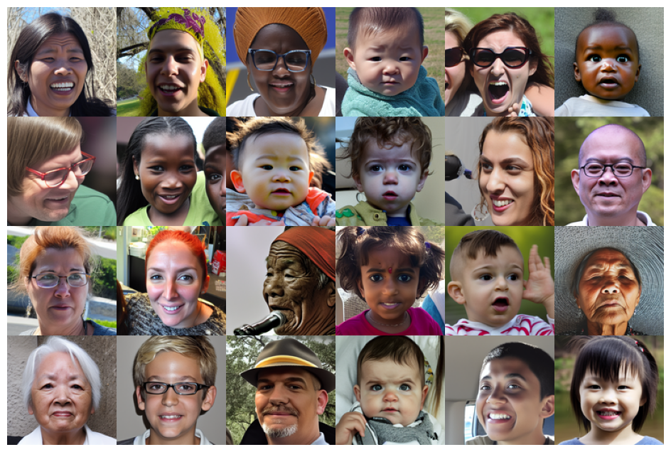
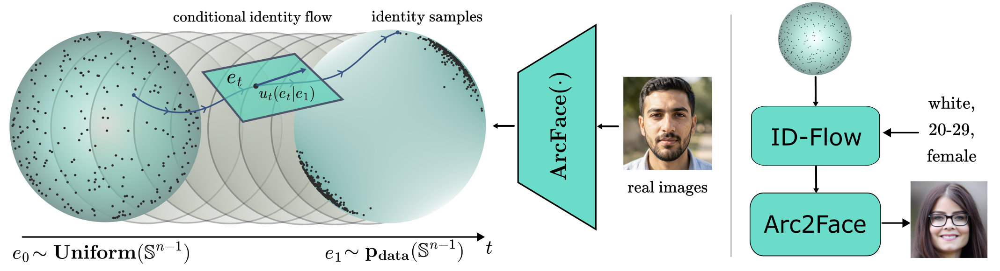

# SynthFaces: Balanced Large Scale Human Dataset

Official code for **ID-Flow**, the controllable identity sampler behind the SynthFaces dataset, and for the
ID-Flow → Arc2Face pipeline that turns sampled identities into face images.

[](https://arxiv.org/abs/2610.40119v1)
[](https://huggingface.co/shredder67/id-flow)
[](https://huggingface.co/datasets/shredder67/synthfaces-faces-balanced)
**Accepted to BMVC 2026.**

> **SynthFaces: Balanced Large Scale Human Dataset**
> Sergey Karpukhin, Denis Bobkov, Kirill Morozov, Aibek Alanov
> [arXiv:2610.40119](https://arxiv.org/abs/2610.40119v1)

<p align="center">
  
</p>

## Context

Face datasets and face-conditional generators are strongly imbalanced across demographic groups, and large real
datasets contain identities that never consented to model training. As a result, identity-preserving generative
models perform unevenly across age, race and gender. The paper proposes a pipeline for building a **balanced,
identity-centric dataset of synthetic people** that can be used to train and fine-tune fairer models:

1. **Identity sampling.** Identity embeddings (ArcFace) live on a unit hypersphere. We train **ID-Flow**, a
   label-conditional geodesic flow-matching model on this manifold, on ~50k deduplicated ArcFace embeddings
   annotated with FairFace age / race / gender labels. With classifier-free guidance it samples new identity
   embeddings for any requested (age, race, gender) combination, so a balanced set of identities can be drawn
   by construction, without access to reference embeddings at inference time.
2. **Face generation.** The sampled embeddings are fed to [Arc2Face](https://github.com/foivospar/Arc2Face), which
   generates multiple face images per identity. A diversity filter in ArcFace space keeps the images of one
   identity varied.
3. **Contextualization.** The released dataset is further processed into high-resolution, captioned images
   (see the paper for details).

Identities are separated from the real training identities, which is measured with the nearest-neighbour
non-leakage metric ID-NonLeak (paper, Table 2).

<p align="center">
  
</p>

## What this repository contains

This repository contains the code for steps 1 and 2:

- **ID-Flow training** (`scripts/train_idflow.py`): a ~11.8M-parameter MLP U-Net with AdaLN label conditioning, trained with
  geodesic conditional flow matching on the sphere (`idflow/`). `configs/idflow_best.json` is the recipe
  used in the paper (depth 2, GELU, Adam with constant lr 3e-4, 1000 epochs, batch size 128, slerp
  interpolation augmentation, guidance scale 2.0). Training takes a few hours on a single GPU.
- **Balanced identity sampling** (`scripts/sample_identities.py`): samples every one of the 9 (age) × 7 (race) ×
  2 (gender) = 126 groups with classifier-free guidance, and keeps an embedding only if its cosine similarity to
  all accepted embeddings of its group is below a threshold (default 0.3).
- **Arc2Face image sampling** (`scripts/sample_images.py`): generates diverse images for each identity (default
  50 per identity), re-extracts ArcFace embeddings from the generated images for the diversity filter, supports
  partitioned multi-GPU sampling and merging.
- **Weight export** (`scripts/export_weights.py`): converts a training checkpoint into a small
  self-describing file that `sample_identities.py` loads directly.
- **Arc2Face model download** (`scripts/download_arc2face.py`).

```
configs/idflow_best.json        training config
idflow/
  model.py                      conditional velocity network
  flow.py                       ID-Flow (Lightning module): training loss + guided sampler
  data.py                       data module (embeddings + labels)
  io.py                         config parsing, checkpoint loading, weight export
  labels.py                     label vocabularies (FairFace classes) and the 126 groups
  arc2face_utils.py             Arc2Face text-encoder wrapper, embedding projection, model loaders
scripts/                        command-line entry points
```

## Installation

```bash
conda create -n synthfaces python=3.10 -y && conda activate synthfaces
pip install -r requirements.txt
```

`requirements.txt` pins the versions the code was tested with (notably `transformers==4.44.2`). Install an
`onnxruntime-gpu` build that matches your CUDA version, otherwise InsightFace runs on CPU and image sampling is slow.

## Pretrained ID-Flow weights

A weights-only checkpoint of the model from the paper (47 MB) is available on the Hugging Face Hub:
[shredder67/id-flow](https://huggingface.co/shredder67/id-flow). It can be passed directly to
`scripts/sample_identities.py --ckpt`.

```bash
huggingface-cli download shredder67/id-flow idflow.pt --local-dir .
```

## Dataset

The balanced SynthFaces face dataset (15,054 identities, 10 images each, 150,540 images at 512x512, with
age / race / gender labels) is available on the Hugging Face Hub:
[shredder67/synthfaces-faces-balanced](https://huggingface.co/datasets/shredder67/synthfaces-faces-balanced).

## Sampling

### 1. Download Arc2Face models

```bash
python scripts/download_arc2face.py --root Arc2Face
```

This creates `Arc2Face/models/{arc2face,encoder,antelopev2}`; Stable Diffusion 1.5 is fetched from the
Hugging Face Hub on first use. The Arc2Face weights are provided by the Arc2Face authors under their own terms
(see [Arc2Face](https://github.com/foivospar/Arc2Face)).

### 2. Sample a balanced set of identities

```bash
python scripts/sample_identities.py \
    --ckpt idflow.pt \
    --n_total 10000 \
    --output_dir outputs/identities
```

This produces `id_embeddings.pt` ((N, 512) unit vectors, ordered by group), `labels.pkl` (`[age, race, gender]`
indices per embedding) and `metadata.json`. Useful options:

| option | default | meaning |
|---|---|---|
| `--id_gs` | 2.0 | classifier-free guidance scale; higher = more label-faithful, less diverse |
| `--similarity_threshold` | 0.3 | max cosine similarity between accepted embeddings of a group |
| `--resume_from DIR` | – | top up an existing run (groups below target are sampled further) |
| `--relaxed_threshold` | – | looser threshold for groups that stay short in `--resume_from` mode (e.g. 0.45) |

Label indices follow `idflow/labels.py`: age `0-2, 3-9, 10-19, 20-29, 30-39, 40-49, 50-59, 60-69, 70+`; race
`White, Black, Latino_Hispanic, East Asian, Southeast Asian, Indian, Middle Eastern`; gender `Male, Female`.

You can also use the model from Python:

```python
import torch
from idflow import load_idflow

model = load_idflow("idflow.pt", device="cuda:0")
y = torch.tensor([[3, 0, 1]] * 16, device="cuda:0")   # age 20-29, White, Female
ids = model.sample(bs=16, y=y, guidance_scale=2.0, device="cuda:0")  # (16, 512), unit norm
```

### 3. Generate images with Arc2Face

```bash
# one command per GPU / part
python scripts/sample_images.py sample \
    --embeddings_path outputs/identities/id_embeddings.pt \
    --output_dir outputs/images \
    --part_idx 0 --n_parts 4 --images_per_identity 50

python scripts/sample_images.py merge --output_dir outputs/images --n_parts 4
```

Progress is checkpointed after every identity, so interrupted runs resume automatically. Images are written to
`outputs/images/merged/images/{identity:06d}_{image:02d}.png`.

## Training ID-Flow

Training needs a set of ArcFace identity embeddings with labels. The embedding data itself is not part of this
repository; prepare a directory with

```
embeddings.pt   FloatTensor (N, 512)  L2-normalised ArcFace embeddings (one per identity)
labels.pt       LongTensor  (N, 3)    class indices, columns = [age, race, gender]
```

Embeddings are extracted with the Arc2Face ArcFace model (`antelopev2/arcface.onnx`, see
`build_face_analyzer` in `idflow/arc2face_utils.py`) and labelled with
[FairFace](https://github.com/dchen236/FairFace). As in the paper, near-duplicate identities should be removed
(pairwise cosine similarity threshold 0.4) before training.

```bash
python scripts/train_idflow.py \
    --config configs/idflow_best.json \
    --data_path data/embeddings \
    --output_dir runs/idflow
```

15% of the identities are held out for validation (`val_fraction` in the config); pass `--val_data_path DIR` to use a
fixed validation set instead. Checkpoints are written to `runs/idflow/checkpoints/` (every 100 epochs and
`last.ckpt`), metrics to `runs/idflow/logs/` (CSV; use `--wandb_project` for Weights & Biases). Then export weights
for sampling:

```bash
python scripts/export_weights.py --ckpt runs/idflow/checkpoints/last.ckpt --out idflow.pt
```

## Roadmap

- [x] ID-Flow training code and pretrained identity sampler
- [x] Identity sampling and Arc2Face image sampling pipeline
- [x] Release of the balanced SynthFaces face dataset
  ([shredder67/synthfaces-faces-balanced](https://huggingface.co/datasets/shredder67/synthfaces-faces-balanced))
- [ ] Release of the high-quality contextualized SynthFaces dataset (planned for a bit later)

## Citation

```bibtex
@article{karpukhin2026synthfaces,
  title   = {SynthFaces: Balanced Large Scale Human Dataset},
  author  = {Karpukhin, Sergey and Bobkov, Denis and Morozov, Kirill and Alanov, Aibek},
  journal = {arXiv preprint arXiv:2610.40119},
  year    = {2026},
  note    = {Accepted to BMVC 2026}
}
```

## License and acknowledgements

The code in this repository is released under the [MIT License](LICENSE). It builds on
[Arc2Face](https://github.com/foivospar/Arc2Face) (MIT code; see [THIRD_PARTY_LICENSES.md](THIRD_PARTY_LICENSES.md)),
[Flow Matching](https://github.com/facebookresearch/flow_matching), [Stable Diffusion 1.5](https://huggingface.co/stable-diffusion-v1-5/stable-diffusion-v1-5),
[InsightFace](https://github.com/deepinsight/insightface) and [FairFace](https://github.com/dchen236/FairFace).
Model weights from these projects are distributed under their own licenses; the Arc2Face and InsightFace weights are
restricted to non-commercial use.
